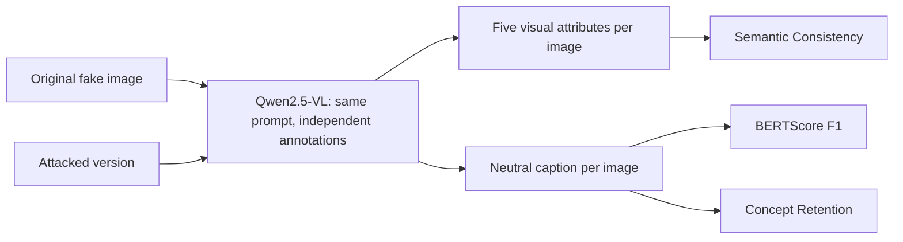

# Semantic Consistency for Deepfake Attack Evaluation

**An NLP and vision-language approach to measuring semantic preservation in adversarially modified face images.**

This project grew out of our work on **DÆLTA** for the **AADD 2026 challenge**.
While examining the attacked images, I noticed a problem that motivated this
extension: an attack can successfully fool a deepfake detector while also
making parts of the portrait less recognizable. Attack success and global
image-similarity scores do not directly explain **which visible attributes
remain recognizable after the attack**.

I developed this NLP extension to investigate that gap. Its main contribution
is a proposed **Semantic Consistency** metric, supported by caption similarity
and lexical retention measurements, that makes these changes easier to inspect.

> **Research question:** when a synthetic face image is modified to evade a
> deepfake detector, does it still preserve the same observable content?

The repository contains the evaluation pipeline, saved annotations and results,
the DÆLTA training and attack scripts, and supporting research materials.

## From the challenge to the research question

[DÆLTA — Dual-branch AutoEncoder Latent Transformation Attack](https://github.com/antonio-Landi/AADD_Challenge)
uses an autoencoder trained on real faces, with RGB and DCT branches, to
transform synthetic face images and test the robustness of deepfake detectors.
The original challenge work evaluates detector evasion and visual quality
using measures such as attack success rate, SSIM and LPIPS.

Inspecting the outputs revealed a qualitative failure case: some attacked
images exhibit a translucent overlay or double-exposure effect. The subject
and accessories may remain visible while the face, apparent head pose or
background becomes harder to interpret. This observation led to a more
specific question than whether the attack works: **what does it preserve?**

This repository develops that question into a separate semantic evaluation
protocol. Its role in deepfake detection research is to assess content
preservation when evaluating adversarial attacks. It does not classify images
as real or fake, verify facial identity, or change the official AADD score.

## Approach

The pipeline uses
[Qwen2.5-VL-3B-Instruct](https://huggingface.co/Qwen/Qwen2.5-VL-3B-Instruct)
to annotate each image independently with the same prompt. Each annotation
contains a short English caption and five controlled visual attributes.



Here, **original** means the synthetic image before the attack; **attacked**
means its transformed version. Neither input is a real-face reference.

| Attribute | Allowed values |
| --- | --- |
| `visible_smile` | `yes`, `no`, `unknown` |
| `eyeglasses` | `yes`, `no`, `unknown` |
| `head_pose` | `frontal`, `three_quarter`, `profile`, `unknown` |
| `headwear` | `yes`, `no`, `unknown` |
| `background_type` | `indoor`, `outdoor`, `plain`, `other`, `unknown` |

The prompt requests a neutral caption starting with `A person` and describing
visible clothing, accessories, pose or background. It excludes demographic
inferences, identity and real/fake judgments. Captions that fail validation are
retried; deterministic fallback captions are recorded and excluded from the
text metrics. The prompt and validation logic are included in
[`nlp_semantic_eval.py`](nlp_semantic_eval.py).

## Metrics and contribution

The contribution is the attribute-based Semantic Consistency metric and its
evaluation protocol for original/attacked face pairs. BERTScore is an existing
metric used as a complementary text baseline; Concept Retention is a simple
lexical diagnostic. The three measurements are reported separately.

### Semantic Consistency

For a pair, consider only attributes whose value in the original image is
different from `unknown`:

```text
Semantic Consistency = matching attributes / evaluable original attributes
```

An attribute counts as preserved only if its value is identical in both
annotations. If a clear original attribute becomes `unknown` after the attack,
it counts as a mismatch. A pair contributes to the dataset mean only when
**at least three of the five original attributes are evaluable**.

For example, if four original attributes are clear and three remain unchanged,
the pair scores `3 / 4 = 0.75`. The dataset result is the mean of eligible pair
scores; per-attribute retention and coverage are also reported.

### Complementary caption metrics

| Metric | Question | Configuration |
| --- | --- | --- |
| **BERTScore F1** | Are the two descriptions linguistically similar? | `roberta-large`; attacked caption as candidate, original caption as reference; `idf=False`, `rescale_with_baseline=False`. |
| **Concept Retention** | How many lexical details from the original caption appear again? | Intersection of the two concept sets divided by the original set size; concepts are filtered tokens and adjacent bigrams. |

[BERTScore](https://arxiv.org/abs/1904.09675) compares contextual token
embeddings. Concept Retention uses exact lexical overlap after filtering:
synonyms such as `hat` and `cap` remain different. Both metrics use only pairs
with two accepted captions. Concept Retention measures what the captions
mention, rather than the fraction of visual content preserved.

## Results

The completed experiment covers **1,600 original/attacked pairs** from the
AADD 2026 test set. The reference outputs are in
[`nlp_semantic_results-All/`](nlp_semantic_results-All/).

| Metric | Mean | Eligible pairs |
| --- | ---: | ---: |
| **Semantic Consistency** | **0.6062** | **1,057 / 1,600** |
| **BERTScore F1** | **0.9507** | **1,508 / 1,600** |
| **Concept Retention** | **0.2612** | **1,508 / 1,600** |

The 543 pairs excluded from Semantic Consistency have fewer than three clear
original attributes. The 92 pairs excluded from the text metrics contain at
least one fallback caption. These exclusions are part of the protocol and are
not residual inference errors: the final cache contains 3,200 image annotations
with no remaining annotation errors.

| Attribute | Matching / evaluable cases | Retention |
| --- | ---: | ---: |
| Visible smile | 460 / 675 | 68.1% |
| Eyeglasses | 111 / 116 | 95.7% |
| Head pose | 922 / 1,600 | 57.6% |
| Headwear | 418 / 535 | 78.1% |
| Background type | 742 / 1,590 | 46.7% |

Per-attribute rates use all pairs where that original attribute is clear,
including pairs excluded from the overall Semantic Consistency mean.

**Main finding:** high caption similarity coexists with lower consistency of
the controlled attributes. In this experiment, head pose and background are
the least stable categories. This supports reporting attribute-level changes
alongside global text similarity. A BERTScore of 0.9507 does not mean that
95% of the visual facts are preserved, and the three scores are not on an
interchangeable scale.

The eyeglasses result has a particularly small denominator: only 116 of 1,600
original annotations provide a clear value. All rates describe the VLM's
annotations under this protocol, not human ground truth.

### Repeatability and execution record

A pilot evaluated 20 pairs. A separate audit repeated greedy inference three
times on each of the 40 pilot images, producing **120 fresh annotations**.
The five-attribute vectors agreed across all repetitions, with zero errors.
This establishes technical repeatability in the pilot; annotation accuracy
requires independent validation. See the
[audit summary](nlp_semantic_results-gready/greedy_stability_summary.json).

The first full pass took **44 h 50 min 7 s** on an NVIDIA GeForce RTX 2060
with 6 GB VRAM and CPU offloading. This timing precedes a separate recovery
of 66 pairs whose 1792-pixel images caused GPU memory errors. Only their failed
annotations were retried, limiting the VLM input to 1024 pixels in memory.
The final results therefore include a mixture of the original preprocessing
and this recovery setting; image files were unchanged.

The [reference summary](nlp_semantic_results-All/summary.json) records
`torch 2.5.1+cu121`, `transformers 5.14.1`, `bert-score 0.3.13`, prompt
`v2_neutral_caption`, and Qwen revision
`66285546d2b821cf421d4f5eb2576359d3770cd3`. Generation used
`do_sample=False`, `num_beams=1` and `max_new_tokens=220`.

## Repository contents

| Path | Purpose |
| --- | --- |
| [`nlp_semantic_eval.py`](nlp_semantic_eval.py) | Main pipeline: annotations, validation, JSONL cache, pair metrics, summaries and optional repeatability audit. |
| [`requirements-nlp.txt`](requirements-nlp.txt) | NLP dependencies, installed after PyTorch, torchvision and Pillow. |
| [`nlp_semantic_results-All/`](nlp_semantic_results-All/) | Reference experiment: `summary.json`, `pairs.csv` and the annotation cache. |
| [`nlp_semantic_results-gready/`](nlp_semantic_results-gready/) | Pilot and greedy repeatability audit. The directory retains its historical spelling. |
| [`nlp_semantic_results-test/`](nlp_semantic_results-test/) and [`nlp_semantic_results-attacked/`](nlp_semantic_results-attacked/) | Early annotation experiments on originals and attacked images. |
| [`nlp_semantic_results-paired/`](nlp_semantic_results-paired/) | Earlier comparison reconstructed from caches; historical results. |
| [`compute_bertscore_from_cache.py`](compute_bertscore_from_cache.py) | Earlier cache-based analysis utility; the main pipeline produces the reference results. |
| [`train-ae-daelta.py`](train-ae-daelta.py) and [`attack-ae-daelta.py`](attack-ae-daelta.py) | DÆLTA training and attack generation, included as the experimental background. |
| [`paper/`](paper/) | Research manuscript and [notes on its NLP additions](paper/AgiuntePaper.md). |
| [`presentazione/`](presentazione/) | Presentation slides and supporting document. |
| [`README.original.md`](README.original.md) | Original Italian README, preserved unchanged as a historical document. |

The source image datasets and trained DÆLTA checkpoint are **not included**.
The published CSV, JSON and JSONL files allow inspection of the reported
results without running the models. Some historical notes refer to paths in
the original challenge workspace.

## Running the evaluation

Run the commands below from this repository's root. The NLP pipeline does
not require the rest of the AADD repository when supplied with image pairs.

### 1. Prepare the environment

Create a virtual environment using a Python version supported by your chosen
PyTorch build:

```bash
python -m venv .venv
```

Activate it with `.venv\Scripts\Activate.ps1` in PowerShell, or
`source .venv/bin/activate` on Linux/macOS. Install compatible **PyTorch and
torchvision** builds using the
[official PyTorch installation instructions](https://pytorch.org/get-started/locally/),
then install the remaining dependencies:

```bash
python -m pip install Pillow
python -m pip install -r requirements-nlp.txt
```

The requirements file provides dependency lower bounds, rather than a locked
reproduction environment. Model weights are downloaded on first use. Inference
can require substantial memory and time; start with a small pilot.

### 2. Supply matching image folders

Prepare one folder of original fake images and one of their attacked versions.
By default, files are paired by **relative path without extension**: for
example, `originals/000.jpg` matches `attacked/000.png`. Matching also respects
subdirectories. Supported formats are PNG, JPG, JPEG, WEBP and BMP.

The scripts retain local paths from the original workspace in their quick
configuration. **Pass all three directory options explicitly**, as below, or
edit those defaults before running. Use a new output folder for new experiments.

Check the matching without loading the VLM:

```bash
python nlp_semantic_eval.py --original-dir "data/originals" --attacked-dir "data/attacked" --output-dir "runs/pilot" --limit 20 --dry-run
```

### 3. Run a pilot, then the full evaluation

```bash
python nlp_semantic_eval.py --original-dir "data/originals" --attacked-dir "data/attacked" --output-dir "runs/pilot" --limit 20
```

Remove `--limit 20` and choose a separate output folder for a full run:

```bash
python nlp_semantic_eval.py --original-dir "data/originals" --attacked-dir "data/attacked" --output-dir "runs/full"
```

The output includes:

- `pairs.csv`: captions, attributes, eligibility status and metrics per pair;
- `summary.json`: aggregate scores, denominators and inference configuration;
- `annotations_*.jsonl`: cached annotations and raw model responses.

| Option | Use |
| --- | --- |
| `--model-revision COMMIT` | Pin the Qwen checkpoint; the default is `main`. The reference revision is recorded above. |
| `--device auto` | Let the model loader place weights on available devices; this is the default. |
| `--skip-bertscore` | Run the attribute and lexical analysis without BERTScore. |
| `--greedy-stability-runs 3` | Add fresh repeated annotations for a small repeatability audit. |
| `--max-image-side 1024` | Limit large VLM inputs in memory; this changes preprocessing. |
| `--retry-failed-cache` | Retry failed cached annotations, preserving successful entries and backing up existing results. |
| `--match-mode relative_path` | Require matching relative paths including file extensions. |

Keep the same input dataset and model configuration when resuming a run.
The cache fingerprint tracks the prompt, model and inference configuration;
image resizing is recorded separately to support selective recovery. For a
new dataset or a fresh preprocessing experiment, use a new output folder.
For memory-error recovery, append `--retry-failed-cache --max-image-side 1024`
to the original command. `--overwrite-cache` replaces cached annotations and
is not the recovery option.

<details>
<summary>Optional: generate attacked images with DÆLTA</summary>

The semantic evaluation accepts already prepared image pairs. To use the
included training and attack scripts, additionally install:

```bash
python -m pip install lpips torch-dct pytorch-msssim
```

Configure `IMG_DIR`, `SAVE_PATH`, `METRICS_SAVE_PATH` and `CHECKPOINT_DIR` in
`train-ae-daelta.py`; configure `WEIGHTS_PATH`, `FAKE_DIR` and `OUTPUT_DIR`
in `attack-ae-daelta.py`. Set a device available on your machine: the attack
script currently selects `cuda:2` when CUDA is present.

```bash
python train-ae-daelta.py
python attack-ae-daelta.py
```

Reproducing the challenge experiment also requires the filtered FFHQ training
subset, compatible trained weights and the AADD evaluation setup. The FFHQ
selection procedure is not implemented in these two scripts. Consult the
[original DÆLTA repository](https://github.com/antonio-Landi/AADD_Challenge)
and the [included manuscript](paper/Manifold_Guided_Adversarial_Attack_of_Deepfake_Detectors_via_Dual_Branch_Autoencoder_Projection.pdf)
for the wider experimental context.

</details>

## Limitations and future work

The current results depend on **one VLM, one prompt and five attributes**.
An annotation change can reflect a visible alteration, reduced readability,
or a systematic model error. The qualitative inspection of the overlay
artifact was not a formal human annotation study. Coverage also differs
substantially across attributes and metrics.

The proposed evaluation is an interpretable research contribution; its novelty
does not imply a demonstrated state-of-the-art result or validated real/fake
classification performance. Independent VLM annotations, equivalent prompt
variants and structured human judgments would help test how well the scores
track meaningful visual changes. These are future directions, not completed
experiments in this repository.
